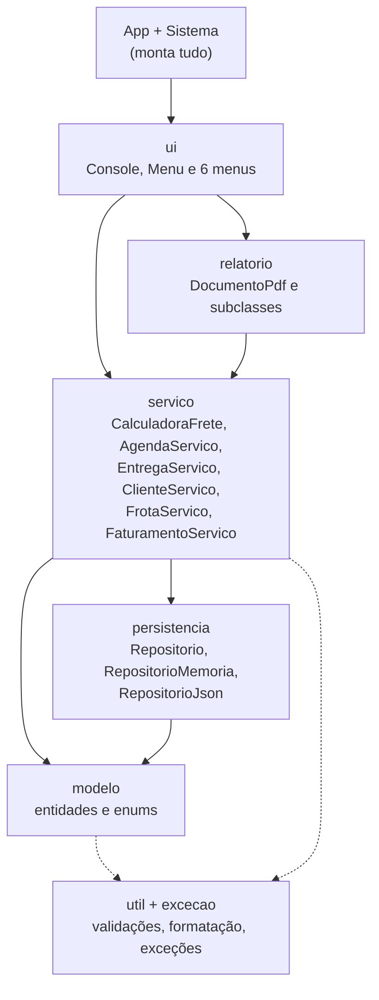
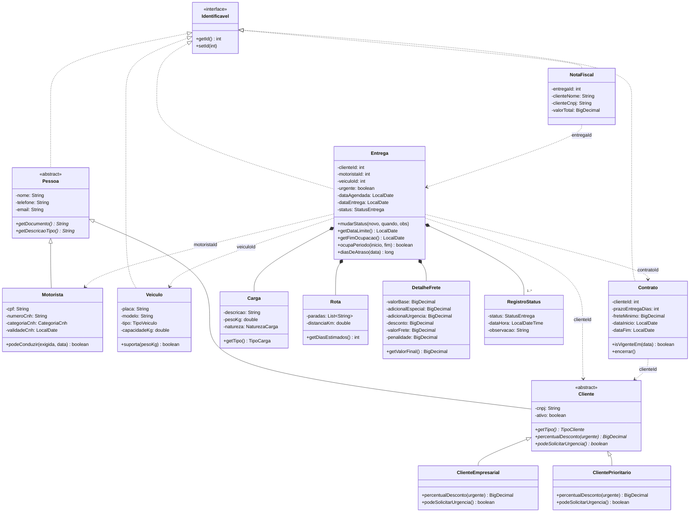
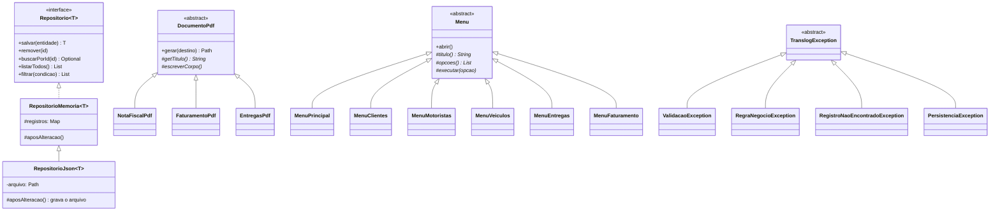
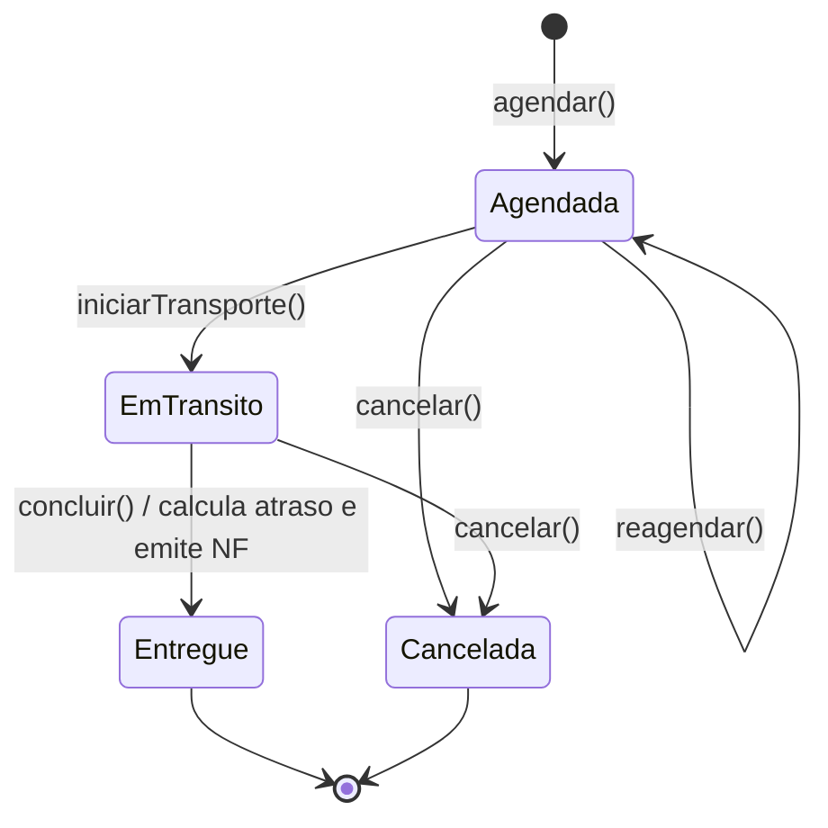
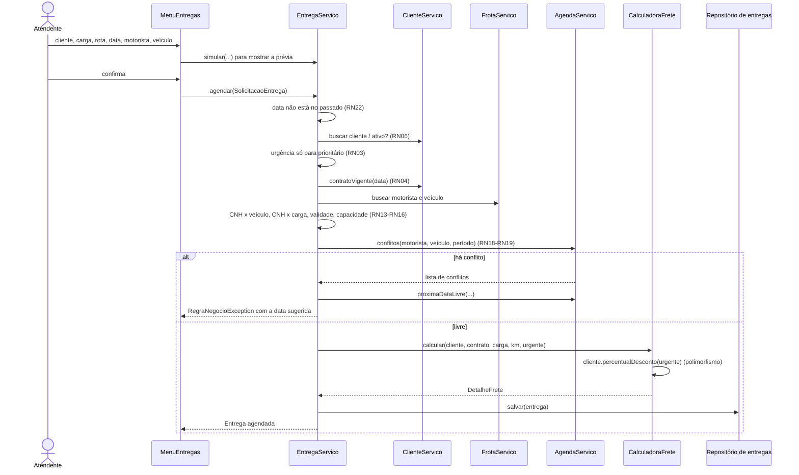

# 2. Arquitetura e diagramas

Os diagramas estão em [Mermaid](https://mermaid.js.org/). O GitHub mostra os diagramas direto na página; no VS Code, use a extensão "Markdown Preview Mermaid Support".

---

## 2.1 Camadas

As dependências seguem um sentido só: a interface chama os serviços, e os serviços usam o modelo e os repositórios. O modelo não conhece ninguém de fora dele.



| Pacote | Responsabilidade | Não pode |
|---|---|---|
| `modelo` | Guardar os dados e as regras que pertencem a um único objeto (ex.: transições de status) | Ler o teclado, gravar arquivo |
| `servico` | Regras que envolvem vários objetos (agendar, faturar) | Ler o teclado, imprimir na tela |
| `persistencia` | Ler e gravar os dados | Ter regra de negócio |
| `relatorio` | Montar os PDFs | Alterar dados |
| `ui` | Conversar com o usuário | Ter regra de negócio |
| `util` / `excecao` | Validações e exceções compartilhadas | — |

Por causa dessa separação, os testes usam os serviços sem console e sem arquivos (`RepositorioMemoria` + `Clock` fixo).

---

## 2.2 Diagrama de classes do modelo



**Por que a `Entrega` guarda ids e não os objetos?** Se ela guardasse o objeto `Cliente`, o JSON das entregas repetiria os dados do cliente em cada entrega. Uma mudança de telefone deixaria cópias diferentes espalhadas. Guardando o id, o cliente existe num lugar só (`clientes.json`).

### Enums

| Enum | Valores | Comportamento |
|---|---|---|
| `TipoCliente` | EMPRESARIAL, PRIORITARIO | cria a subclasse certa de `Cliente` |
| `TipoCarga` | LEVE, MEDIA, PESADA | valor por km, peso máximo e CNH mínima; `classificar(peso)` |
| `NaturezaCarga` | COMUM, FRAGIL, PERIGOSA | `exigeTransporteEspecial()` |
| `CategoriaCnh` | A, B, C, D, E | `habilita(exigida)` |
| `TipoVeiculo` | UTILITARIO, VAN, CAMINHAO_TOCO, CAMINHAO_TRUCK, CARRETA | CNH mínima de cada tipo |
| `StatusEntrega` | AGENDADA, EM_TRANSITO, ENTREGUE, CANCELADA | `podeMudarPara(novo)`, `isPendente()` |

---

## 2.3 Hierarquias de apoio



---

## 2.4 Ciclo de vida da entrega (RN20)



Qualquer outra transição (por exemplo, de Agendada direto para Entregue) lança `RegraNegocioException`.

---

## 2.5 Sequência do agendamento (RF07)



---

## 2.6 Arquivos gerados

```
dados/
├── clientes.json        lista de clientes, cada um com o campo "tipo"
├── contratos.json
├── motoristas.json
├── veiculos.json
├── entregas.json        cada entrega com carga, rota, frete e histórico
├── notas-fiscais.json
└── relatorios/
    ├── nota-fiscal-000001.pdf
    ├── faturamento-AAAAMMDD-AAAAMMDD.pdf
    ├── faturamento-cliente-N-AAAAMMDD.pdf
    └── entregas-AAAAMMDD.pdf
```

Exemplo de um cliente no JSON (o campo `tipo` permite recriar a subclasse certa):

```json
{
  "cnpj": "09378657000161",
  "ativo": true,
  "id": 2,
  "nome": "Farmácia Vida Nordeste S.A.",
  "telefone": "86988123030",
  "email": "compras@vidanordeste.com.br",
  "tipo": "PRIORITARIO"
}
```
