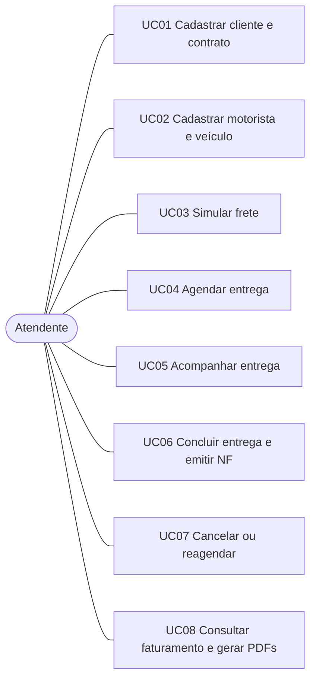

# 4. Casos de uso

**Ator:** atendente da transportadora (operação e financeiro).
Os casos de uso abaixo cobrem o fluxo principal do sistema. Os códigos RN estão em [01-especificacao-de-requisitos.md](01-especificacao-de-requisitos.md).

---

## UC01 – Cadastrar cliente e contrato
**Menu:** Clientes e contratos → 1

**Fluxo principal**
1. O atendente escolhe o tipo (Empresarial ou Prioritário).
2. Informa razão social, CNPJ, telefone e e-mail (os dois últimos são opcionais).
3. O sistema valida o CNPJ (RN28) e confere se ele já não está cadastrado (RN29).
4. O sistema pede os dados do contrato: prazo em dias, frete mínimo, condições e vigência.
5. O sistema salva o cliente e o contrato.

**Fluxos alternativos**
- 3a. CNPJ inválido ou repetido → mensagem de erro; nada é salvo.
- 4a. Data de término antes do início → mensagem de erro; o cliente fica salvo sem contrato e o contrato pode ser registrado depois pela opção 7.

---

## UC02 – Cadastrar motorista e veículo
**Menus:** Motoristas → 1 e Veículos → 1

**Fluxo principal (motorista)**
1. Informa nome, CPF, contatos, número da CNH (11 dígitos), categoria e validade.
2. O sistema valida o CPF (RN28), o número da CNH e a unicidade (RN29).
3. Se a CNH já estiver vencida, o cadastro é feito com um aviso.

**Fluxo principal (veículo)**
1. Informa placa, modelo, tipo (utilitário, van, caminhão toco, truck ou carreta), capacidade e ano.
2. O sistema valida a placa (RN28), a capacidade (até 60.000 kg) e o ano.

---

## UC03 – Simular frete
**Menu:** Entregas → 1

1. Escolhe o cliente e informa a carga e a distância.
2. Se o cliente for prioritário, o sistema pergunta se a entrega é urgente.
3. O sistema mostra a memória de cálculo completa (base, adicionais, desconto, frete mínimo).

Nada é gravado.

---

## UC04 – Agendar entrega
**Menu:** Entregas → 2

**Pré-condição:** o cliente tem contrato.

**Fluxo principal**
1. O atendente escolhe o cliente; o sistema mostra o prazo e o frete mínimo do contrato.
2. Informa a descrição, o peso e a natureza da carga; o sistema mostra a classificação (RN07).
3. Informa as cidades da rota (separadas por `;`) e a distância.
4. Para cliente prioritário, informa se é urgente (RN03).
5. Informa a data de saída (padrão: amanhã).
6. O sistema lista só os motoristas aptos e livres no período (RN13, RN15, RN19).
7. O sistema lista só os veículos com capacidade e livres (RN16, RN19).
8. O atendente escolhe o motorista e o veículo.
9. O sistema mostra a prévia do frete e a data limite sem multa; o atendente confirma.
10. O sistema verifica todas as regras e salva a entrega com status Agendada.

**Fluxos alternativos**
- 9a. A viagem estimada é maior que o prazo do contrato → o sistema avisa do risco de multa e deixa continuar.
- 10a. CNH incompatível com o veículo ou com a carga → erro com a categoria exigida (RN13, RN14).
- 10b. Peso acima da capacidade → erro com o peso e a capacidade (RN16).
- 10c. Motorista ou veículo já reservado → erro com a entrega que ocupa a data e a **próxima data livre** (RN19).
- 10d. Sem contrato vigente na data → erro (RN04).
- 10e. Data no passado → erro (RN22).

---

## UC05 – Acompanhar entrega
**Menus:** Entregas → 3, 4, 5, 10 e Painel geral

- Lista por prioridade: urgentes pendentes primeiro (RN23).
- Filtra por status.
- Detalha uma entrega com a memória de cálculo e o histórico (RN21).
- Lista as pendentes com prazo vencido.
- Painel: totais por status, faturamento do mês, atrasadas, saídas da semana, CNHs vencendo.

---

## UC06 – Concluir entrega e emitir nota fiscal
**Menu:** Entregas → 6 (iniciar) e 7 (concluir)

**Fluxo principal**
1. No dia da saída, o atendente inicia o transporte; o status vai para Em trânsito.
2. Na chegada, o atendente informa a data da entrega (padrão: hoje) e uma observação.
3. O sistema calcula os dias de atraso em relação ao prazo (RN24) e aplica o abatimento (RN25).
4. O status vai para Entregue e a nota fiscal é emitida (RN26).
5. O sistema oferece gerar o PDF da nota.

**Fluxos alternativos**
- 1a. Antes da data de saída → erro; é preciso reagendar (RN22).
- 2a. Entrega que não está em trânsito → erro (RN20).
- 2b. Data futura ou anterior à saída → erro (RN22).

---

## UC07 – Cancelar ou reagendar
**Menu:** Entregas → 8 e 9

- **Cancelar:** pede confirmação e motivo. Permitido para Agendada ou Em trânsito. A agenda é liberada na hora.
- **Reagendar:** só para Agendada. A nova data passa de novo pela agenda, pelo contrato e pela validade da CNH.

---

## UC08 – Consultar faturamento e gerar PDFs
**Menu:** Faturamento e notas fiscais

1. Lista e consulta as notas.
2. Mostra o faturamento de um cliente num período: notas, total bruto, descontos, abatimentos, total líquido e ticket médio.
3. Gera os PDFs: nota fiscal, faturamento geral (todos os clientes) e faturamento de um cliente.

Os PDFs ficam em `dados/relatorios/`.
